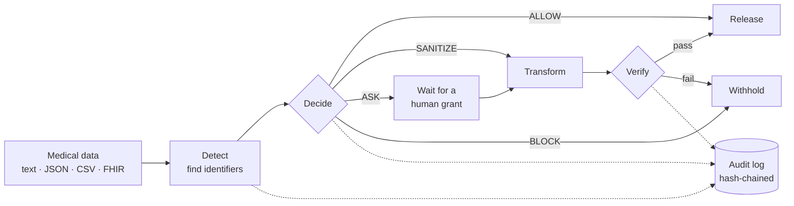
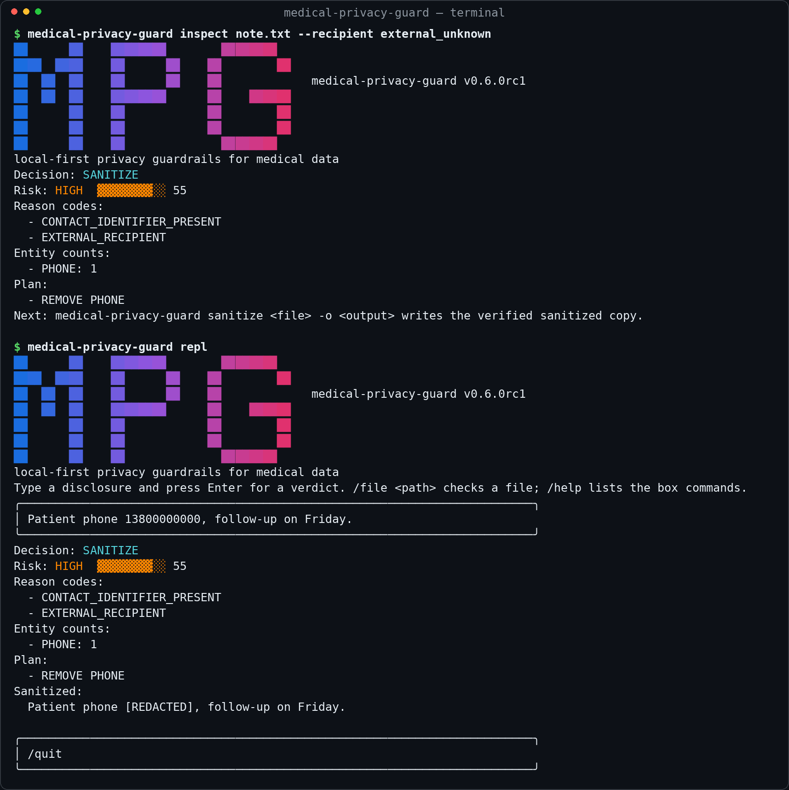

# medical-privacy-guard

[](https://pypi.org/project/medical-privacy-guard/)
[](https://github.com/mokuyoaxis/medical-privacy-guard/actions/workflows/ci.yml)
[](https://github.com/mokuyoaxis/medical-privacy-guard/actions/workflows/security.yml)
[](LICENSE)
[](pyproject.toml)

**English** | [简体中文](README.zh-CN.md)

> Deterministic detection, rewriting and re-verification of medical data on your own machine, before it leaves for an external model.

## What it is: a local checkpoint on the way out

Picture a typical clinical-assistance setup. You want an external model to
summarise a clinical note, but the text contains a patient's name, phone
number, admission date and bed number. The moment that text is pasted and
sent, it is outside your control and cannot be taken back.

`medical-privacy-guard` is built for that moment. It steps in before the
send: it finds the sensitive parts of the payload, rewrites what can be
rewritten safely, and then re-checks the result. Only a payload that passes
verification is released. When a case is high-risk or the guard cannot be
sure, the data is withheld; ASK cases wait for a human decision. Everything
runs locally. No external model is called, and nothing is reported to any
remote server.



## Verdicts, measured

Under the strict profile (`external-ai-strict`), this is how the guard
behaves, by payload and by recipient:

| Payload | Recipient | Verdict | What happens |
|---|---|---|---|
| Short record with a name and a phone number | Unknown external | SANITIZE | Identifiers rewritten; released after re-verification passes |
| Full note with name, age, date, hospital, department, bed and phone | Unknown external | ASK | Held in full until a human issues a grant |
| Record whose rewrite still leaves recognisable features | Approved recipient | SANITIZE (not released) | The verdict stands; verification fails and the output is withheld |

The first row, as an actual run:

```text
In:      患者：测试患者甲，电话 13800000000
Out:     患者：[PERSON_NAME_001]，电话 [REDACTED]
Verdict: SANITIZE, released after verification
```

Give the guard a fuller note and it stops being accommodating. The verdict
is ASK, and not one character is released before a grant exists. Even for an
approved recipient, output that fails verification is withheld. This will
sometimes block things you wanted to send, and it adds approval work. That
is the trade, stated plainly: **the guard does not release data it has not
verified.**

## Getting started

### Install and check

From PyPI:

```bash
python -m pip install medical-privacy-guard
```

From source, for development:

```bash
git clone https://github.com/mokuyoaxis/medical-privacy-guard
cd medical-privacy-guard
python -m pip install -e ".[test]"
python -m pytest -q
```

### Python SDK

```python
from medical_privacy_guard import Guard

guard = Guard(profile="external-ai-strict")
result = guard.sanitize(
    "患者：测试患者甲，电话 13800000000",
    recipient="external_unknown",
    purpose="EXTERNAL_AI_ASSISTANCE",
)

if result.released:
    payload_to_release = result.text
```

`Guard`, `Verdict`, the result types and the guard exception classes are
the stable public API. The subpackages are implementation details.

### Command line



```bash
medical-privacy-guard inspect note.txt --json
medical-privacy-guard sanitize note.txt -o note.sanitized.txt --audit-dir audit/
medical-privacy-guard benchmark tests/fixtures/synthetic_cn_notes
medical-privacy-guard audit-verify audit/
medical-privacy-guard report --audit-dir audit/ -o report.html
medical-privacy-guard report --dataset cohort.csv --quasi-identifier age --quasi-identifier sex -o report.html
```

Exit codes carry the verdict, which makes the CLI easy to wire into a
pipeline:

| Code | Normal commands | `audit-verify` |
|---|---|---|
| 0 | ALLOW, or SANITIZE that passed verification | Audit hash chain intact |
| 2 | BLOCK | Audit hash chain broken |
| 3 | ASK, waiting for a human | Not applicable |
| 4 | Parse, configuration or internal error | Parse, configuration or internal error |

### Zero-code HTTP gateway

If your application already talks to the OpenAI or Anthropic SDK, no code
needs to change. Point the client's `base_url` at the local gateway:

```bash
medical-privacy-guard serve --upstream https://api.openai.com --port 8787
# OpenAI-compatible client: base_url="http://127.0.0.1:8787/v1"
# Anthropic client:        base_url="http://127.0.0.1:8787"
```

- **One-way control.** The gateway intercepts and rewrites requests on
  `/v1/chat/completions` and `/v1/messages` and forwards them to a single
  fixed upstream. Responses pass through uninspected.
- **A small network surface.** It binds to loopback by default, and a
  request cannot choose a different upstream. Use
  `--recipient external_approved` only for endpoints the deployment has
  formally approved.
- **Safe error reporting.** ASK and BLOCK return HTTP 403 with reason codes
  and risk metadata only. Payload text is never echoed back.
- **Other shapes.** The project also ships in-process wrappers for
  OpenAI-compatible and Anthropic clients, and an MCP stdio gateway that
  applies the same verdicts to `tools/call`.

## How it works: a four-step pipeline and a tamper-evident audit log

The core is a deterministic four-stage pipeline, plus one audit chain:

1. **Detect.** Rules only — no model, no network calls. The detectors find
   phone numbers, resident ID candidates that satisfy the GB 11643-1999
   check digit, labelled and unlabelled names, medical record numbers,
   addresses, hospitals, departments, wards, bed numbers, ages and exact
   dates in Chinese clinical text.
2. **Decide.** Each payload gets exactly one verdict: **ALLOW**,
   **SANITIZE**, **ASK** or **BLOCK**. A detected type that no policy rule
   covers fails closed to **BLOCK**. It never slides to ALLOW.
3. **Transform.** Sensitive spans are removed, masked, tokenised,
   date-shifted or generalised — dates to the month, ages to bands, places
   and institutions to type markers.
4. **Verify.** The rewritten text is scanned again, and anything that
   fails is withheld. The risk score always describes the input *before*
   transformation: a high-risk input can earn SANITIZE, but only verified
   output may leave.

**Tamper-evident audit.** When audit is enabled, every verdict is written
to a log that holds metadata only, never raw values. Entries are
hash-chained, so a deletion, an edit or a reordering can be detected, and
an HMAC key can be set with `MEDICAL_PRIVACY_GUARD_AUDIT_KEY`. The
cryptographic limit, stated plainly: without a key, truncating the tail of
the log or rewriting the whole chain is not detectable.

**Approvals and grants.** ASK is not a dead end. A deployment can issue a
grant for a pending request — scoped, expiring, limited in uses, and signed
with a key the payload itself cannot reach. A granted release is still a
minimised release: the grant means the deployment accepts the residual risk
of one value that cannot be rewritten, not that transformation is switched
off. Grant consumption is tracked in-process by default, or in a private
local SQLite registry with revocation. See
[docs/approval-workflow.md](docs/approval-workflow.md) and
[docs/grant-registry.md](docs/grant-registry.md).

**Structured data and medical images.**

- JSON, CSV and a minimal FHIR resource set are flattened into string
  leaves, checked and transformed with the key or column name as the field
  label, then rebuilt in their original shape. JSON numbers are inspected
  but never rewritten: a number that matches an identifier withholds the
  whole record rather than quietly changing its type.
- The DICOM tool `dicom-inspect` is read-only. It reports identifying
  metadata tags and never modifies a file. Burned-in pixel text is an
  unknown risk, so the tool never calls an image file "safe".

**Evaluation, and what it does not prove.** The benchmark corpus holds 175
synthetic Chinese clinical notes: 140 with 1,474 labelled spans across 24
types, and 35 with no identifiers at all. Under the strict profile, each
document's full lifecycle and audit trail is checked; the declared outcomes
are 135 SANITIZE, 5 ASK, and ALLOW for every identifier-free note. A
separate hand-written corpus tests generalisation, and the detectors are
deliberately not tuned to it. One limit is worth stating in the README
itself: **a perfect score on synthetic data shows the system agrees with
its own templates.** What each number does and does not establish is in
[docs/evaluation.md](docs/evaluation.md).

## Boundaries and safety statements

### Not covered yet

- **Office and layout documents**: XLSX and TSV (CSV covers the same
  need), PDF and DOCX.
- **Deep DICOM de-identification**: writing files back, and erasing
  pixel-level content.
- **General networking and multimodal input**: a general HTTP egress proxy
  beyond the OpenAI and Anthropic paths; images, audio and video.
- **Higher-level analysis and protocol surface**: full dataset-level
  re-identification analysis (basic aggregate measurements are in
  [docs/datasets.md](docs/datasets.md)); `resources/read` and `prompts/get`
  inspection in the MCP gateway.

### Four things it will never promise

Read these before putting the tool in a workflow. They are not fine print,
and they do not soften.

1. **No compliance certification.** This tool is not a certification of
   HIPAA, GDPR, PIPL or any institutional policy. It lowers the engineering
   risk of sending sensitive data out by accident. It does not replace
   legal review or a formal compliance audit.
2. **De-identification is not anonymisation.** The aim is lower risk, not
   no risk. What remains — a rare diagnosis, an unusual visit date, a very
   small ward — can still point to one person in the right context.
3. **No defence against insiders who hold raw access.** Any process or
   person who can read the raw data can bypass the guard entirely. It
   exists for engineering accidents — an agent pasting in too much context,
   a pipeline sending the wrong file — not for deliberate theft.
4. **Blocking only covers visible failures.** Verification cannot catch an
   identifier the detectors missed. "Nothing detected" and "safe" are
   different claims, and scanning twice with the same rules leaves the same
   blind spots in place.

The full, authoritative capability boundary is
[docs/scope.md](docs/scope.md); the threat model is
[docs/threat-model.md](docs/threat-model.md). The three bundled policy
presets are compared in [docs/policy-profiles.md](docs/policy-profiles.md).

## Data rules and status

**Synthetic data only.** Every example and test in this repository uses
hand-built placeholders, reserved example domains, private IP ranges,
`SYNTH-*` identifiers and one documented public checksum example. Do not
submit real patient records, production audit logs, screenshots,
credentials or token mappings in issues, pull requests, fixtures or CI
artefacts. See [CONTRIBUTING.md](CONTRIBUTING.md).

**Status and origins.**

- **Current stable**: v0.6.2 — a dataset re-identification risk section
  in the `report`, an explicit benchmark over-redaction rate, and
  detector fixes from the challenge-corpus evidence line, on top of the
  static HTML audit and grant report.
- **Previous stable**: v0.6.1 — the static HTML audit and grant report
  (`report`, in English and Simplified Chinese), on top of the stable
  public API, a single `medical_privacy_guard` namespace, and the
  zero-code gateway.
- **Roadmap**: earlier milestones (the text core, the Chinese detection and
  evaluation line, CSV/JSON, structured formats and egress adapters) and
  the road to **v1.0, a medical AI egress privacy gateway**, are in
  [ROADMAP.md](ROADMAP.md); the full history is in
  [CHANGELOG.md](CHANGELOG.md).

Some of this project's engineering philosophy comes from the earlier
[agent-guard](https://github.com/mokuyoaxis/agent-guard) project. The two
are independent, with different threat models and implementations, but they
share an outlook: avoid the mistakes that can be avoided, tighten the
boundaries you are unsure of, and keep every decision on record.

## License

MIT License — see [LICENSE](LICENSE).
