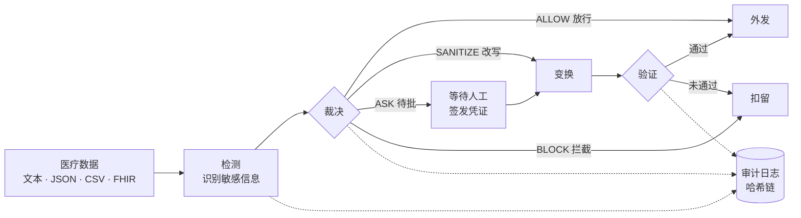
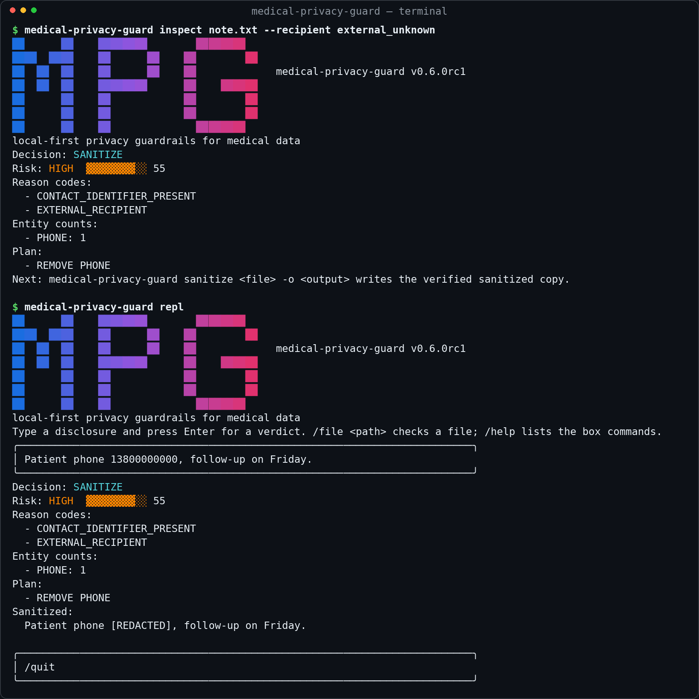

# medical-privacy-guard

[](https://github.com/mokuyoaxis/medical-privacy-guard/actions/workflows/ci.yml)
[](https://github.com/mokuyoaxis/medical-privacy-guard/actions/workflows/security.yml)
[](LICENSE)
[](pyproject.toml)

[English](README.md) · **简体中文**

> 在医疗数据离开本地流向外部大模型之前，于本机完成确定性的隐私检测、改写与二次核验。

## 核心定位：本地出站隐私防线

设想一个典型的临床辅助场景：你希望借助外部大模型总结一份病历，但文本中包含患者的姓名、电话、入院日期与床位号。一旦将这些内容直接粘贴并发出，敏感信息便脱离了本地控制边界，无法撤回。

`medical-privacy-guard` 专为拦截这一出站时刻而设计。它在数据发送前介入，自动识别文本中的敏感信息，对可安全脱敏的字段执行改写，并在改写后强制执行二次复查；只有验证通过的载荷才会被放行。遇到高风险或无法确信的场景时，系统会扣留数据并转交人工审批。全流程在本地闭环运行，不依赖外部模型，也不会向任何远端服务器上报数据。



## 裁决行为与实测效果

在严格策略（`external-ai-strict`）下，系统针对不同敏感密度与接收方信任等级的执行表现如下：

| 载荷特征 | 接收方类型 | 裁决结果 | 处置行为 |
|---|---|---|---|
| 含姓名与电话的简短记录 | 未知外部方 | SANITIZE | 敏感项改写且复检通过后放行 |
| 含姓名、年龄、日期、院科床号与电话的完整病历 | 未知外部方 | ASK | 全文扣留，等待人工签发凭证 |
| 改写后仍残留可识别特征的记录 | 已批准接收方 | SANITIZE（未放行） | 二次验证未通过，输出扣留不予外发 |

以简短记录为例，向未知外部方发送单条文本时的实际脱敏效果如下：

```text
输入：患者：测试患者甲，电话 13800000000
输出：患者：[PERSON_NAME_001]，电话 [REDACTED]
结果：裁决 SANITIZE，二次验证通过后放行
```

当病历包含完整的患者画像与就诊轨迹时，系统会直接给出 **ASK** 裁决，在获得人工授权前不放行任何字符；即便接收方属于已批准端点，只要变换后的输出未能通过二次验证，数据依然会被扣留。这种设计在极端情况下会产生误拦摩擦，但这是系统的显式取舍：**宁可承担多拦带来的审批成本，也绝不放行未经核验的数据。**

## 快速接入与部署

### 本地安装与验证

```bash
git clone https://github.com/mokuyoaxis/medical-privacy-guard
cd medical-privacy-guard
python -m pip install -e ".[test]"
python -m pytest -q
```

### Python SDK

```python
from medical_privacy_guard import Guard

guard = Guard(profile="external-ai-strict")
result = guard.sanitize(
    "患者：测试患者甲，电话 13800000000",
    recipient="external_unknown",
    purpose="EXTERNAL_AI_ASSISTANCE",
)

if result.released:
    payload_to_release = result.text
```

`Guard`、`Verdict`、结果类型及 Guard 异常类属于稳定的公共 API；其余各子包均为内部实现细节。

### 命令行工具



```bash
medical-privacy-guard inspect note.txt --json
medical-privacy-guard sanitize note.txt -o note.sanitized.txt --audit-dir audit/
medical-privacy-guard benchmark tests/fixtures/synthetic_cn_notes
medical-privacy-guard audit-verify audit/
```

命令行通过标准退出码表达裁决状态，便于嵌入自动化管线：

| 退出码 | 常规命令含义 | 审计校验含义 |
|---|---|---|
| 0 | ALLOW 或验证通过的 SANITIZE | 审计哈希链完整 |
| 2 | BLOCK 拦截 | 审计哈希链断裂 |
| 3 | ASK 待人工审批 | 不适用 |
| 4 | 解析、配置或内部错误 | 解析、配置或内部错误 |

### 零代码 HTTP 网关

若现有应用已接入 OpenAI 或 Anthropic SDK，无需修改业务逻辑，仅需将客户端 `base_url` 指向本地网关即可完成接入：

```bash
medical-privacy-guard serve --upstream https://api.openai.com --port 8787
# OpenAI 兼容客户端：base_url="http://127.0.0.1:8787/v1"
# Anthropic 客户端：  base_url="http://127.0.0.1:8787"
```

* **单向出站管控**：网关拦截并改写 `/v1/chat/completions` 与 `/v1/messages` 请求，转发至唯一固定的上游端点；上游响应原样透传，不做检查。
* **网络与权限收敛**：服务默认仅绑定本地回环地址，客户端请求无权动态指定上游；仅当目标端点确属部署方正式批准时，才应启用 `--recipient external_approved`。
* **安全报错降级**：触发 **ASK** 或 **BLOCK** 时返回 HTTP 403，响应体仅包含原因码与风险元数据，绝不回显原始文本。
* **多形态扩展**：除独立网关外，项目还提供进程内 OpenAI 兼容与 Anthropic 客户端包装器，以及对 `tools/call` 执行同等裁决机制的 MCP stdio 网关。

## 架构机制：四步管线与防篡改审计

系统核心架构由四阶段确定性管线与一条独立审计链构成：

1. **检测**：采用纯规则引擎，不调用模型、不发起网络请求。支持识别中文临床文本中的手机号、符合 GB 11643-1999 校验位规则的居民身份证候选值、带标签与无标签姓名、病历号、地址、医院、科室、病区、床号、年龄及精确日期等敏感实体。
2. **裁决**：每份载荷仅生成唯一裁决（**ALLOW**、**SANITIZE**、**ASK** 或 **BLOCK**）。若检出的敏感类型未被当前策略规则显式覆盖，系统一律执行默认拒绝（Fail-closed）并收敛至 **BLOCK**，绝不滑向放行。
3. **变换**：按策略对敏感跨度执行删除、掩码、令牌化、日期平移或泛化（如日期精确至月、年龄归入年龄段、地点与机构替换为类别标记）。
4. **验证**：对变换后的文本执行二次扫描，未通过核验的载荷一律扣留。系统报告的风险分始终反映**变换前输入**的原始风险——高风险输入可以获得 **SANITIZE** 裁决，但只有验证通过的输出才被允许离开本地。

**防篡改审计账本**
启用审计后，每次裁决都会写入仅包含元数据（绝不记录原文）的审计日志。日志条目通过哈希链首尾相接，任何删除、篡改或顺序调换均可被检出，并支持通过环境变量 `MEDICAL_PRIVACY_GUARD_AUDIT_KEY` 启用 HMAC 签名。需要坦诚说明的密码学边界是：若未配置签名密钥，攻击者截断日志尾部或重写整条哈希链将无法被检出。

**人工审批与受限凭证**
**ASK** 并非死胡同。部署方可以针对待批请求签发限定作用范围、有效期与使用次数的审批凭证（Grant），并使用载荷本身无法触达的密钥进行签名。获批放行依然遵循最小化原则——凭证仅代表部署方愿意承担某项无法改写值的残余风险，而非关闭脱敏变换。凭证消费记录默认在进程内追踪，也可通过本地私有 SQLite 登记表实现持久化与吊销，详见 [docs/approval-workflow.md](docs/approval-workflow.md) 与 [docs/grant-registry.md](docs/grant-registry.md)。

**结构化数据与医学影像支持**
* **结构化文本**：JSON、CSV 与最小 FHIR 资源集会被展开为字符串叶子节点，以键名或列名作为字段标签完成检测与变换，再按原结构重建。JSON 数值类型仅做检查而不做改写——若数字命中标识符模式，系统直接扣留整条记录，绝不静默篡改字段类型。
* **DICOM 扫描**：只读工具 `dicom-inspect` 仅报告可识别的元数据标签，从不修改原文件；由于像素层面的烧录文字风险未知，该工具绝不会宣称任何影像文件“安全”。

**评测基准与认识论边界**
评测基于一套包含 175 篇合成中文病历的基准语料：其中 140 篇包含跨 24 个类别的 1474 个标注跨度，其余样本不含任何标识符。在严格策略下逐篇核对完整生命周期与审计门，标准预期结果为 135 篇 **SANITIZE**、5 篇 **ASK**，无标识符样本全部 **ALLOW**。此外，项目维护了一套独立手写语料专门测试泛化能力，且刻意避免针对该语料回调检测器参数。需要强调的是：**在合成数据上跑出满分，仅证明系统与自身的生成模板自洽**；关于各项指标的实际证明力边界，请参阅 [docs/evaluation.md](docs/evaluation.md)。

## 能力边界与安全声明

### 当前尚未覆盖

* **办公与排版文档**：XLSX、TSV（同类表格需求已由 CSV 覆盖）、PDF 与 DOCX。
* **影像深度脱敏**：DICOM 文件回写及像素级敏感信息擦除。
* **通用网络与多模态**：非 OpenAI/Anthropic 路径的通用 HTTP 出站代理，以及图像、音频、视频等多模态内容。
* **高阶分析与扩展协议**：完整的数据集级重识别分析（初步聚合度量见 [docs/datasets.md](docs/datasets.md)），以及 MCP 网关中的 `resources/read` 与 `prompts/get` 拦截。

### 核心安全声明：四个“永不承诺”

在将本工具引入工作流之前，请务必审阅以下不可妥协的能力边界：

1. **不提供合规认证**：本工具不构成 HIPAA、GDPR、《个人信息保护法》（PIPL）或机构内部合规政策的认证。它能降低意外外发敏感数据的工程风险，但无法替代法律审查与正式合规审计。
2. **去标识化不等于匿名化**：脱敏旨在降低风险，而非彻底消除风险。残留的罕见诊断、特殊就诊日期或小规模病区等准标识符组合在一起，在特定背景下仍可能指向具体个人。
3. **不防御拥有原始权限的内部主体**：任何具备原始数据读取权限的进程或人员均可直接绕过本组件。本工具防范的是工程意外（如 Agent 上下文拼接越界、自动化管线误传文件），而非恶意内部窃密。
4. **安全拦截仅针对“可见的失败”**：二次验证无法拦截检测器本身未能识别的漏检项（False Negatives）。“未检出敏感词”与“绝对安全”是两个概念；用同一组规则扫描两次，原有的检测盲区依然存在。

关于系统能力的完整权威定义请参阅 [docs/scope.md](docs/scope.md)，安全威胁模型请参阅 [docs/threat-model.md](docs/threat-model.md)。

## 数据规范与演进路线

**仅使用合成数据**
本仓库的所有示例与测试均采用人工构造的占位符、保留示例域名、私有 IP 地址段、`SYNTH-*` 标识符及公开说明的校验示例。严禁在 Issue、Pull Request、测试固件或 CI 产物中提交真实患者记录、生产环境审计日志、截图、密钥凭据或 Token 映射表。详见 [CONTRIBUTING.md](CONTRIBUTING.md)。

**版本状态与设计渊源**
* **当前候选版**：v0.6.0-rc.1，提供稳定公共 API、统一的 `medical_privacy_guard` 命名空间与零代码网关。
* **最新稳定版**：v0.5.0，实现 ASK 审批凭证、SQLite 凭证登记与本地审批工作流。
* **演进路线**：早期里程碑（文本核心、中文检测与评测线、CSV/JSON、结构化格式与出站适配器）及未来演进目标（**v1.0：医疗 AI 出站隐私网关**）详见 [ROADMAP.md](ROADMAP.md)，完整变更记录见 [CHANGELOG.md](CHANGELOG.md)。

本项目的部分工程哲学源于更早的 [agent-guard](https://github.com/mokuyoaxis/agent-guard) 项目。两者相互独立，威胁模型与具体实现各不相同，但底层的安全观一脉相承：**能规避的错误尽量规避，拿不准的边界果断收紧，所有裁决留痕可查。**

## 许可证

本项目基于 MIT License 开源，详见 [LICENSE](LICENSE)。